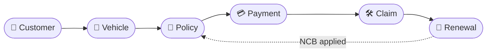
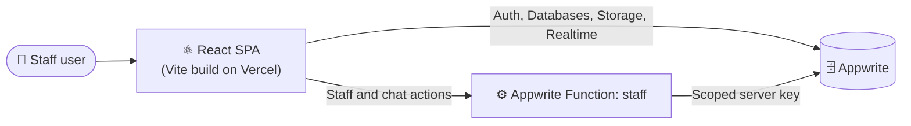
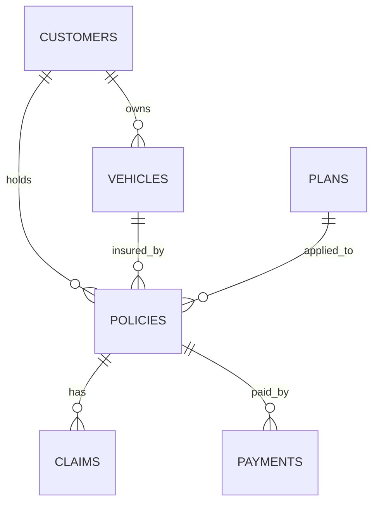
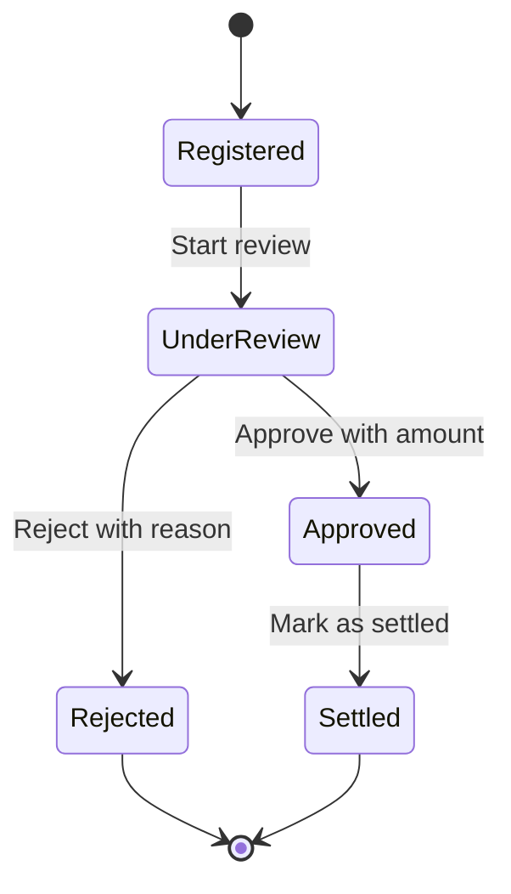
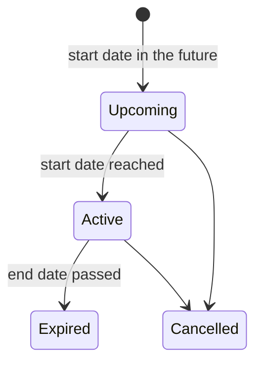
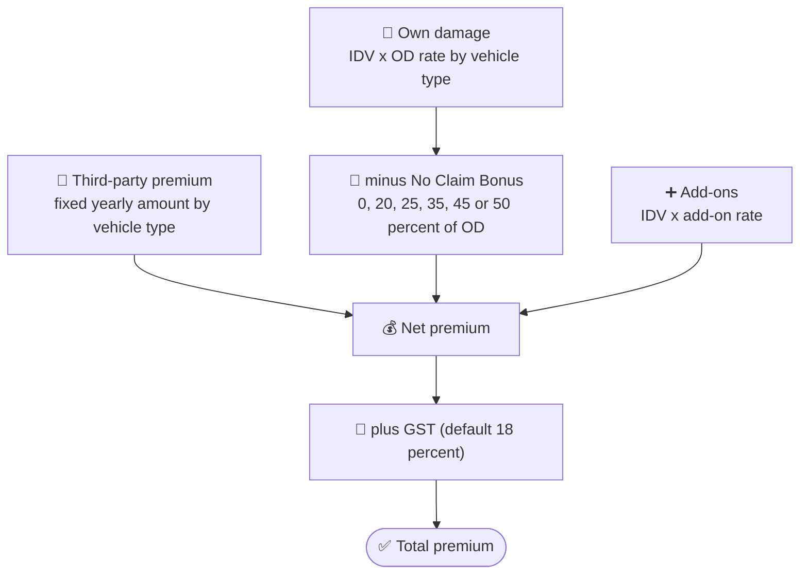

<div align="center">


<a href="https://safehaveninsure-admin.vercel.app/">
  
</a>

<br />

**The motor insurance admin panel that feels as premium as the cover it sells.**

<br />

[](https://safehaveninsure-admin.vercel.app/)
[](#-quick-start)

<br />


</div>

<br />

## 🧭 Contents

<table>
<tr>
<td>

- [✨ Why SafeHavenInsure](#-why-safehaveninsure)
- [🚀 Highlights](#-highlights)
- [🧩 Features](#-features)
- [💬 Staff Chat](#-staff-chat)
- [🎨 Design System](#-design-system)
- [⚙️ How It Works](#️-how-it-works)

</td>
<td>

- [🔐 Roles & Permissions](#-roles--permissions)
- [🛠️ Tech Stack](#️-tech-stack)
- [⚡ Quick Start](#-quick-start)
- [📖 Detailed Setup](#-detailed-setup)
- [🌍 Deployment](#-deployment)
- [📁 Project Structure](#-project-structure)

</td>
<td>

- [🏎️ Performance](#️-performance)
- [🛡️ Security](#️-security)
- [🩺 Troubleshooting](#-troubleshooting)
- [🗺️ Roadmap](#️-roadmap)

</td>
</tr>
</table>

---

## ✨ Why SafeHavenInsure

Small agencies often run on spreadsheets, paper registers and chat groups. Renewals slip, claims get lost and premiums are worked out by hand, which is exactly where mistakes creep in.

**SafeHavenInsure keeps the whole journey in one place.** A single record follows a customer from vehicle registration to policy, payment, claim and renewal, and every action is attributed to the staff member who made it.



<br />

## 🚀 Highlights

|     | Feature                      | What you get                                                                                      |
| :-: | :--------------------------- | :------------------------------------------------------------------------------------------------ |
| 🧮  | **Automatic premiums**       | Third party, own damage, No Claim Bonus, add-ons and GST calculated live while a policy is issued |
| 🔔  | **Renewals that never slip** | Expiring and recently lapsed policies in one list, with NCB handled for you                       |
| 📋  | **Full claim lifecycle**     | Registered, Under Review, Approved or Rejected, then Settled, with a history trail                |
| 🛡️  | **Three roles**              | Super Admin, Admin and Employee, enforced by the backend and not only by the UI                   |
| 💬  | **Role-aware staff chat**    | Realtime messaging, role badges, unread dots and strict who-can-message-whom rules                |
| 🌗  | **Light and dark themes**    | A navy, blue and teal palette that adapts to both modes with no flash on load                     |
| ⚡  | **Instant feel**             | Code-split pages that preload in the background, cached data and optimistic saves                 |
| 🖨️  | **Print ready**              | Policy certificates and payment receipts                                                          |

<br />

## 🧩 Features

<details open>
<summary><b>🏢 Insurance operations</b></summary>

<br />

| Module                 | What it does                                                                                                                                                                                                  |
| :--------------------- | :------------------------------------------------------------------------------------------------------------------------------------------------------------------------------------------------------------ |
| 👥 **Customers**       | Contact details, city and KYC status, with search and filters                                                                                                                                                 |
| 🚘 **Vehicles**        | Registration number, make, model, year, fuel and type (Car, Two-Wheeler, Commercial), linked to the owner and marked insured or uninsured                                                                     |
| 📦 **Policy plans**    | Third Party, Comprehensive and Own Damage base plans, plus add-ons (Zero Depreciation, Engine Protect, Roadside Assistance, Return to Invoice, Consumables Cover). Plans can be edited and switched on or off |
| 📝 **New policy flow** | Pick customer and vehicle, choose a plan and add-ons, enter the IDV and review the premium breakdown before issuing                                                                                           |
| 📄 **Policies**        | Status is always derived from dates (Upcoming, Active, Expired). A policy can be cancelled with a reason. Printable certificate                                                                               |
| 🔁 **Renewals**        | Policies expiring within 60 days and those lapsed in the last 90 days. NCB moves to the next slab when no claim was made and resets after a claim                                                             |
| 🛠️ **Claims**          | Board and list views, approved amount, remarks, status history and protection against duplicate claims for the same incident                                                                                  |
| 💳 **Payments**        | Pending and paid collections by UPI, Card, Net Banking or Cash, with printable receipts                                                                                                                       |

</details>

<details>
<summary><b>📊 Insight and reporting</b></summary>

<br />

- **Dashboard**: KPIs, revenue and collection charts, plan mix, renewal buckets, claims pipeline, top cities and recent activity.
- **Reports**: period-based figures, monthly series and tables that download as CSV.
- **Data export**: a full Excel workbook (one sheet per data group) and a JSON backup from Settings.

</details>

<details>
<summary><b>👨‍💼 Team, security and collaboration</b></summary>

<br />

- **Staff management**: add employees, approve them, change roles, block or unblock, reset passwords, view login history and revoke sessions.
- **Activity log**: every create, update and delete is recorded, and each role sees only what it is allowed to.
- **Staff chat**: realtime and role-aware, see [Staff Chat](#-staff-chat).
- **Sign-in**: email and password, optional Google and GitHub, password recovery and a "keep me signed in on this device" option.

</details>

<details>
<summary><b>🎛️ Experience</b></summary>

<br />

- Responsive layout: a collapsible sidebar on desktop, and on phones an always-visible icon rail plus a slide-over menu.
- A header that never overlaps: phones show the current page title, larger screens show the full breadcrumb.
- Light and dark themes with no flash on load.
- Global search (`Ctrl + K`), toasts, confirmation dialogs and skeleton loaders.
- Profile page with avatar and cover image upload.

</details>

<!--
Screenshots: add images to docs/screenshots/ and uncomment this block.

## 📸 Screenshots

| Dashboard (light) | Dashboard (dark) |
| --- | --- |
|  |  |

| New policy | Chat |
| --- | --- |
|  |  |
-->

<br />

## 💬 Staff Chat

A private, realtime messenger built into the panel. Every person carries a role badge (**Super Admin**, **Admin**, **Employee**), so nobody has to guess who they are talking to.

| Who            | Can start a chat with     | Can delete a chat                 |
| :------------- | :------------------------ | :-------------------------------- |
| 👑 Super Admin | Admins and Employees      | Any conversation, for both people |
| 🧑‍💼 Admin       | Super Admin and Employees | Own conversations with Employees  |
| 🧑‍💻 Employee    | Admins only               | Never                             |

- 🔵 **Unread dot**: a dot appears on the Chat icon when something new arrives. Opening that conversation clears it immediately, and the read position follows you to your other devices.
- 👁️ **View-only oversight**: the Super Admin can read conversations between other staff members, clearly marked as view only.
- 🧹 **Always clean**: when a user is deleted, all of their conversations are removed. When a user is blocked, their conversations disappear from every list and return if they are unblocked.
- 🔒 **Enforced on the server**: the `staff` function checks every send and every delete, so the rules hold even if the interface is bypassed.

<br />

## 🎨 Design System

A deep navy base, a confident blue and a fresh teal accent. One palette, two moods.

|                                    Swatch                                     | Role                                         | Hex       |
| :---------------------------------------------------------------------------: | :------------------------------------------- | :-------- |
|  | Deep Navy: hero surfaces and brand gradients | `#15324B` |
|  | Royal Blue: buttons, links and focus rings   | `#2563EB` |
|  | Teal: highlights and accents                 | `#14B8A6` |
|  | Mist: light theme background                 | `#F4F7FB` |
|  | Midnight Slate: dark theme background        | `#0F172A` |

Colours are defined once as design tokens in `src/index.css`, so the whole interface follows the palette. Typography pairs **Sora** for display text with **Plus Jakarta Sans** for the interface. Animations respect `prefers-reduced-motion`.

<br />

## ⚙️ How It Works

### 🏗️ Architecture



The front end is a static build, so it can live on any host. Anything that needs elevated rights (creating users, changing roles, resetting passwords, delivering and deleting chat messages) runs in the `staff` function, never in the browser.

### 🗃️ Data model



Supporting collections: `settings`, `messages`, and three activity collections (`activity_super`, `activity_admin`, `activity_employee`) so that visibility follows the role hierarchy.

### 🔄 Claim lifecycle



### 📆 Policy status



> [!NOTE]
> Status is calculated from dates every time, and only a cancellation is stored. It can never drift out of date.

### 🧮 Premium calculation



Own damage, NCB and add-ons apply only to plans that include own-damage cover. Policies run for one year, and every rate and the GST percentage can be edited in Settings.

<details>
<summary><b>📐 Default rates</b></summary>

<br />

| Vehicle type | Yearly third-party premium | Own-damage rate (% of IDV) |
| :----------- | -------------------------: | -------------------------: |
| Car          |                  Rs. 2,094 |                        3 % |
| Two-Wheeler  |                    Rs. 714 |                      1.7 % |
| Commercial   |                  Rs. 7,200 |                      3.2 % |

| Add-on              | Rate (% of IDV) |
| :------------------ | --------------: |
| Zero Depreciation   |          0.40 % |
| Engine Protect      |          0.25 % |
| Roadside Assistance |          0.10 % |
| Return to Invoice   |          0.30 % |
| Consumables Cover   |          0.15 % |

These are starting values. A Super Admin can change all of them in **Settings**.

</details>

<br />

## 🔐 Roles & Permissions

| Capability                                                      |    👑 Super Admin    |         🧑‍💼 Admin          | 🧑‍💻 Employee |
| :-------------------------------------------------------------- | :------------------: | :-----------------------: | :---------: |
| View business data                                              |          ✅          |            ✅             |     ✅      |
| Create and edit customers, vehicles, policies, claims, payments |          ✅          |            ❌             |     ✅      |
| Delete records                                                  |          ✅          |            ❌             |     ❌      |
| Configure plans, rates, GST and company details                 |          ✅          |            ❌             |     ❌      |
| Add and view staff                                              |          ✅          |            ✅             |     ❌      |
| Approve users and change roles                                  |          ✅          |            ❌             |     ❌      |
| View activity log                                               |      Everyone's      |        Employees'         |  Own only   |
| Chat                                                            | Admins and Employees | Super Admin and Employees | Admins only |

Roles are stored as Appwrite user labels. The interface hides what a role cannot do, and Appwrite collection permissions plus the server-side function enforce it.

<br />

## 🛠️ Tech Stack

| Layer           | Technology                                              |
| :-------------- | :------------------------------------------------------ |
| 🖼️ UI           | React 19, React Router 7                                |
| ⚡ Build tool   | Vite 8                                                  |
| 🎨 Styling      | Tailwind CSS 4                                          |
| 📈 Charts       | Recharts                                                |
| 🔣 Icons        | Lucide React                                            |
| 📑 Excel export | SheetJS, loaded only when exporting                     |
| 🗄️ Backend      | Appwrite: Auth, Databases, Storage, Realtime, Functions |
| ☁️ Hosting      | Vercel (any static host works)                          |
| 🧹 Code quality | ESLint with React Hooks rules                           |

<br />

## ⚡ Quick Start

For people who already have Node.js and an Appwrite project:

```bash
git clone https://github.com/<your-username>/SafeHavenInsure-Admin.git
cd SafeHavenInsure-Admin
npm install
cp .env.example .env          # Windows CMD: copy .env.example .env
# fill in .env, then:
npm run setup:appwrite
npm run dev
```

Open `http://localhost:5173` and sign in with the Super Admin from your `.env`.

<br />

## 📖 Detailed Setup

### Prerequisites

- [Node.js](https://nodejs.org/) 20.19 or newer (22 recommended) and npm
- [Git](https://git-scm.com/)
- A free [Appwrite Cloud](https://cloud.appwrite.io/) project, or a self-hosted Appwrite instance

### 1️⃣ Clone and install

```bash
git clone https://github.com/<your-username>/SafeHavenInsure-Admin.git
cd SafeHavenInsure-Admin
npm install
```

### 2️⃣ Environment variables

```bash
cp .env.example .env
```

| Variable                                      |  Required  | Description                                                       |
| :-------------------------------------------- | :--------: | :---------------------------------------------------------------- |
| `VITE_APPWRITE_ENDPOINT`                      |     ✅     | Appwrite API endpoint, for example `https://cloud.appwrite.io/v1` |
| `VITE_APPWRITE_PROJECT_ID`                    |     ✅     | Your Appwrite project ID                                          |
| `VITE_OAUTH_PROVIDERS`                        |  Optional  | Comma separated list: `google,github`                             |
| `APPWRITE_API_KEY`                            | Setup only | Server API key used by the setup script                           |
| `OWNER_EMAIL`, `OWNER_NAME`, `OWNER_PASSWORD` | Setup only | First Super Admin account                                         |

Create the API key in the Appwrite Console under your project's API keys, with access to databases, storage, functions and users.

### 3️⃣ Provision the backend

```bash
npm run setup:appwrite
```

The script creates the database, every collection with its permissions and the storage bucket, deploys the `staff` function and creates the first Super Admin. It is safe to run again: existing resources are skipped or updated. Run it again whenever `functions/staff` changes, so the function is redeployed.

> [!IMPORTANT]
> When the script finishes, delete the API key in the Appwrite Console and remove `APPWRITE_API_KEY` and `OWNER_PASSWORD` from `.env`. The running app never uses them.

### 4️⃣ Allow your URL in Appwrite

In the Appwrite Console go to **Overview > Platforms > Add platform > Web** and add `localhost`. Add your live hostname the same way after deployment.

### 5️⃣ Optional: Google and GitHub sign-in

Enable the providers in **Auth > Settings** in the Appwrite Console, then list them in `VITE_OAUTH_PROVIDERS`.

### 6️⃣ Run

```bash
npm run dev
```

### 📜 Available scripts

| Command                  | Description                              |
| :----------------------- | :--------------------------------------- |
| `npm run dev`            | Start the development server             |
| `npm run build`          | Create a production build in `dist/`     |
| `npm run preview`        | Preview the production build locally     |
| `npm run lint`           | Run ESLint                               |
| `npm run setup:appwrite` | Provision or update the Appwrite backend |

<br />

## 🌍 Deployment

The app is a static build, so it runs on Vercel, Netlify, Cloudflare Pages, Appwrite Sites and similar hosts. The live version runs on **Vercel**.

<details open>
<summary><b>▲ Vercel (command line)</b></summary>

<br />

1. `vercel.json` is already included, so deep links such as `/dashboard` survive a refresh:

   ```json
   {
     "rewrites": [{ "source": "/(.*)", "destination": "/index.html" }]
   }
   ```

2. Install the CLI and sign in:

   ```bash
   npm i -g vercel
   vercel login
   ```

3. Create the project:

   ```bash
   vercel
   ```

4. Add the public variables, choosing **Production** and **Preview**:

   ```bash
   vercel env add VITE_APPWRITE_ENDPOINT
   vercel env add VITE_APPWRITE_PROJECT_ID
   vercel env add VITE_OAUTH_PROVIDERS
   ```

5. Deploy to production:

   ```bash
   vercel --prod
   ```

6. In Appwrite, add the hostname (for example `safehaveninsure-admin.vercel.app`) under **Overview > Platforms > Add platform > Web**.

</details>

<details>
<summary><b>🐙 Vercel (from GitHub)</b></summary>

<br />

Import the repository in the Vercel dashboard, keep the detected Vite settings (build command `npm run build`, output directory `dist`), add the same `VITE_` variables and deploy. Every push to `main` then redeploys automatically.

</details>

<details>
<summary><b>🟢 Netlify (drag and drop)</b></summary>

<br />

1. Create `.env` with the `VITE_` values and run `npm run build`.
2. Drag the generated `dist/` folder into [app.netlify.com/drop](https://app.netlify.com/drop).
3. Add the live hostname in Appwrite under **Overview > Platforms > Web**.

`public/_redirects` is included, so refreshing a deep link such as `/dashboard` works.

</details>

<details>
<summary><b>🔷 Appwrite Sites</b></summary>

<br />

1. Run `npm run build`, then create `code.tar.gz` from the contents of `dist/`.
2. In **Sites**, create a site, upload the archive as a manual deployment and set the SPA fallback file to `index.html`.
3. Add the site's hostname as a Web platform.

</details>

> [!WARNING]
> `VITE_` values are embedded at build time. After changing them, rebuild and redeploy. Never add `APPWRITE_API_KEY` or `OWNER_PASSWORD` to your hosting provider.

<br />

## 📁 Project Structure

```
SafeHavenInsure-Admin/
├── functions/staff/          Appwrite function: staff management and chat
├── public/                   Favicon, theme initializer, SPA redirect rule
├── scripts/
│   └── setup-appwrite.mjs    One-command backend provisioning
├── vercel.json               SPA rewrite for Vercel
└── src/
    ├── components/
    │   ├── common/           Reusable UI: tables, modals, cards, fields, badges
    │   ├── forms/            Customer and vehicle forms
    │   └── layout/           Sidebar, navbar, global search, footer, app shell
    ├── context/              Auth, data, theme (light and dark) and toast providers
    ├── data/                 Default plans and settings
    ├── hooks/                Shared hooks
    ├── lib/                  Appwrite client, activity log, chat directory and unread
    │                         tracking, route preloading
    ├── pages/                One file per screen
    └── utils/                Premium maths, printable documents, image helpers
```

<details>
<summary><b>🧭 App routes</b></summary>

<br />

| Route                                            | Page              | Access                |
| :----------------------------------------------- | :---------------- | :-------------------- |
| `/login`, `/forgot-password`, `/reset-password`  | Authentication    | Public                |
| `/dashboard`                                     | Dashboard         | Signed in             |
| `/customers`, `/vehicles`, `/plans`              | Master data       | Signed in             |
| `/policies`, `/renewals`, `/claims`, `/payments` | Operations        | Signed in             |
| `/policies/new`                                  | New policy        | Roles that can write  |
| `/reports`, `/chat`, `/profile`                  | Insight and tools | Signed in             |
| `/staff`                                         | Staff management  | Super Admin and Admin |
| `/activity`                                      | Activity log      | Role based            |
| `/settings`                                      | Settings          | Super Admin           |

</details>

<br />

## 🏎️ Performance

- ⚡ **Code splitting**: every page is a separate chunk, and heavy libraries such as the Excel writer load only when needed.
- 🔮 **Route preloading**: pages load in the background after sign-in and on sidebar hover, focus or touch, so tab switches feel instant.
- 🗂️ **Cached data**: the last loaded data renders immediately while fresh data loads in the background.
- 🚀 **Optimistic updates**: changes appear instantly and roll back with an error message if saving fails.
- 📡 **Realtime sync**: changes made by other staff, and new chat messages, appear without a refresh.

<br />

## 🛡️ Security

- 🔑 `.env` is git-ignored. Never commit keys or passwords.
- 🌐 Only variables prefixed with `VITE_` are bundled into the front end, and they are public by design.
- 🗑️ Delete the setup API key from the Appwrite Console after provisioning.
- 🧱 Access rules live in Appwrite collection permissions and the server-side function, not only in the interface.
- 💬 Chat permissions (who can message whom, who can delete) are checked on the server for every request.
- ✅ New employees added by an Admin stay pending until a Super Admin approves them.

<br />

## 🩺 Troubleshooting

<details>
<summary><b>Sign-in fails with a CORS or "origin not allowed" error</b></summary>

<br />

Add the site's hostname as a Web platform in the Appwrite Console (**Overview > Platforms**). This is needed for `localhost` and for every live domain.

</details>

<details>
<summary><b>Refreshing a page such as /dashboard shows "Page not found"</b></summary>

<br />

The host needs a single-page fallback. On Vercel make sure `vercel.json` exists with the rewrite shown above. On Netlify the included `public/_redirects` handles it. On Appwrite Sites set the fallback file to `index.html`.

</details>

<details>
<summary><b>The page is blank or says Appwrite is not configured</b></summary>

<br />

`VITE_APPWRITE_ENDPOINT` and `VITE_APPWRITE_PROJECT_ID` must be present when the site is built. On Vercel add them with `vercel env add`, then run `vercel --prod` again.

</details>

<details>
<summary><b>Data does not load after signing in</b></summary>

<br />

Run `npm run setup:appwrite` once so the database and collections exist, and make sure your user has a role label (`superadmin`, `admin` or `employee`).

</details>

<details>
<summary><b>Staff page or chat shows "Function scopes are missing", or deleting chats does nothing</b></summary>

<br />

Run `npm run setup:appwrite` again. It redeploys the `staff` function with the scopes it needs. Redeploy after every update that touches `functions/staff`.

</details>

<details>
<summary><b>The chat dot does not clear</b></summary>

<br />

Make sure the latest build is deployed and hard refresh with `Ctrl + Shift + R`. The dot clears when you open the conversation that sent the message, not when you open the Chat page.

</details>

<details>
<summary><b><code>npm install</code> fails on the Excel library</b></summary>

<br />

The `xlsx` package is downloaded from `cdn.sheetjs.com`. Check that your network or proxy allows that host.

</details>

<br />

## 🗺️ Roadmap

- [ ] 📧 Renewal reminders by email or SMS
- [ ] 📄 PDF export for reports
- [ ] 📎 Document uploads on claims, such as photos and FIR copies
- [ ] 🏢 Multi-branch support
- [ ] 🧪 Automated tests for the premium calculation
- [ ] 👥 Group chats and file sharing in staff chat

<br />

## 🤝 Contributing

Ideas and pull requests are welcome.

1. Fork the repository
2. Create a branch: `git checkout -b feature/my-idea`
3. Commit your changes: `git commit -m "Add my idea"`
4. Push the branch: `git push origin feature/my-idea`
5. Open a pull request

<br />

<div align="center">

**[✦ Open the live app ✦](https://safehaveninsure-admin.vercel.app/)**

Built with care for people who keep other people's journeys safe.


&copy; SafeHavenInsure. All rights reserved.

</div>
